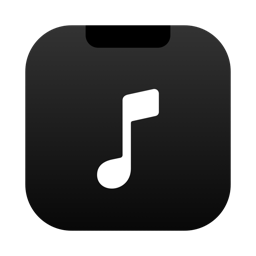

<p align="center">
  
</p>

<h1 align="center">YouTube Lyric Notch</h1>

<p align="center">Chrome에서 틀어 둔 유튜브 노래의 곡 이름과 싱크 가사를 맥북 노치와 잠금 화면에 띄워 주는 macOS 앱입니다.</p>

## 설치

1. `YouTubeLyricNotch-<버전>.dmg`를 열고 `YouTube Lyric Notch`를 **Applications**로 끌어다 놓아 주세요.
2. 응용 프로그램에서 **YouTube Lyric Notch**를 열어 주세요.
   - "열 수 없음" 경고가 뜨면 앱을 우클릭한 뒤 **열기**를 눌러 주세요. 시스템 설정 > 개인정보 보호 및 보안 > **그래도 열기**로도 열 수 있어요.
3. "Google Chrome을 제어하려고 합니다" 창이 뜨면 **허용**을 눌러 주세요.
4. Chrome 메뉴에서 **보기 > 개발자 > Apple Events의 자바스크립트 허용**을 켜 주세요.
   - Chrome 프로필마다 따로 켜야 해요. 유튜브를 트는 프로필에서 켜 주세요.

macOS 14 이상과 Google Chrome이 필요해요.

## 사용법

- Chrome에서 유튜브 음악(뮤비, 플레이리스트 영상)을 틀면 노치 양옆에 썸네일과 막대가 나타나요.
- 노치에 마우스를 올리면 곡 이름, 진행 바, 가사, 이전·재생/정지·다음 버튼이 나와요.
- 키보드의 **F7 / F8 / F9**로 이전·재생/정지·다음을 조작할 수 있어요.
- 화면을 잠그면 시계 아래에 곡과 가사 카드가 나타나요.
- 노치를 펼친 채 **우클릭**하면 로그인할 때 자동으로 열기와 종료를 고를 수 있어요.

플레이리스트 영상은 제목 → 설명란 → 댓글의 타임라인 순서로 지금 나오는 곡을 찾아요. 타임라인이 고정 댓글에만 있어도 괜찮아요.

## 직접 빌드

```bash
./release.sh
```

`release/` 폴더에 앱과 dmg가 만들어져요. 개발 중에 바로 실행해 보려면 아래 명령을 쓰면 돼요.

```bash
swiftc -O main.swift -o notch && ./notch
```
