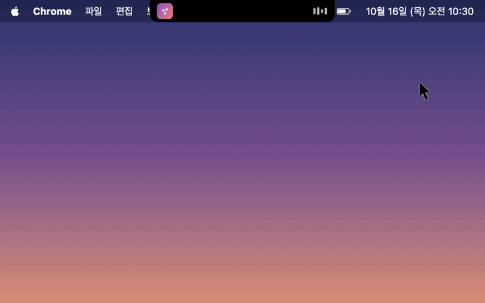

<p align="center">
  
</p>

<h1 align="center">YouTube Lyric Notch</h1>

<p align="center">브라우저에서 틀어 둔 유튜브 노래의 곡 이름과 싱크 가사를 맥북 노치와 잠금 화면에 띄워 주는 macOS 앱입니다. Windows 판도 있어요.</p>

<p align="center">
  
  <br>
  <sub>데모용 곡과 가사로 만든 화면입니다.</sub>
</p>

## 설치

1. `YouTubeLyricNotch-<버전>.dmg`를 열고 `YouTube Lyric Notch`를 **Applications**로 끌어다 놓아 주세요.
2. 응용 프로그램에서 **YouTube Lyric Notch**를 열어 주세요.
   - "열 수 없음" 경고가 뜨면 앱을 우클릭한 뒤 **열기**를 눌러 주세요. 시스템 설정 > 개인정보 보호 및 보안 > **그래도 열기**로도 열 수 있어요.
3. "Google Chrome을 제어하려고 합니다" 창이 뜨면 **허용**을 눌러 주세요.
4. Chrome 메뉴에서 **보기 > 개발자 > Apple Events의 자바스크립트 허용**을 켜 주세요.
   - Chrome 프로필마다 따로 켜야 해요. 유튜브를 트는 프로필에서 켜 주세요.

macOS 14 이상과 Google Chrome이 필요해요.

## 사용법

- Chrome에서 유튜브 음악(뮤비, 플레이리스트 영상)을 틀면 노치 양옆에 썸네일과 막대가 나타나요.
- 노치에 마우스를 올리면 곡 이름, 진행 바, 가사, 이전·재생/정지·다음 버튼이 나와요.
- 키보드의 **F7 / F8 / F9**로 이전·재생/정지·다음을 조작할 수 있어요.
- 화면을 잠그면 시계 아래에 곡과 가사 카드가 나타나요.

### 설정

펼친 노치 왼쪽 위의 **⚙️** 또는 메뉴 막대의 **♪** 아이콘에서 설정을 열 수 있어요.

- **가사 보기 방식**
  - 노치에 마우스를 올려서 보기: 필요할 때만 노치를 펼쳐서 가사를 봐요.
  - 화면에 떠 있는 가사 창: 메뉴 막대 아래에 반투명한 가사 창이 계속 떠 있어요. 끌어서 원하는 곳으로 옮길 수 있고, 옮긴 자리는 기억해요.
- **배경 진하기**: 떠 있는 가사 창의 배경을 조절해요. 0으로 하면 배경 없이 글자만 보여요.
- **가사 타이밍**: 가사가 노래보다 먼저 넘어가면 늘리고, 늦게 넘어가면 줄여 주세요. 기본은 0.5초 늦게예요(플레이리스트 타임라인이 실제 노래보다 조금 이른 경우가 많아서요).
- **메뉴 막대에 아이콘 보이기**: 끄면 메뉴 막대의 ♪ 아이콘을 숨겨요. 숨긴 뒤에는 응용 프로그램에서 앱을 다시 열면 설정 창이 열려요.
- **로그인할 때 자동으로 열기**
- **종료**: 설정 창이나 메뉴 막대 ♪ 메뉴에서 끌 수 있어요.

플레이리스트 영상은 제목 → 설명란 → 댓글의 타임라인 순서로 지금 나오는 곡을 찾아요. 타임라인이 고정 댓글에만 있어도 괜찮아요.

## Windows

Windows에는 노치가 없어서, 화면 위 가운데의 작은 **아일랜드**가 그 자리를 대신해요.

1. [Releases](https://github.com/hongs-lab/youtube-lyric-notch/releases)에서 `YouTubeLyricNotch-<버전>-windows-x64.zip`을 받아 압축을 풀고 `YouTubeLyricNotch.exe`를 실행해 주세요.
   - "Windows의 PC 보호" 창이 뜨면 **추가 정보 > 실행**을 눌러 주세요. 코드 서명 인증서가 없는 앱이라 그래요.
2. Chrome·Edge·Firefox·웨일에서 유튜브 음악을 틀면 화면 위 가운데에 아일랜드가 나타나요. 마우스를 잠깐 올려 두면 곡, 가사, 재생 버튼이 펼쳐져요. 접혀 있을 때는 클릭이 아래 창으로 그대로 통과해요.
3. 작업 표시줄의 트레이 아이콘에서 설정과 종료를 할 수 있어요. 앱을 한 번 더 실행해도 설정 창이 열려요.
   - 설정: 가사 보기 방식(아일랜드 / 떠 있는 가사 창), 배경 진하기, 가사 타이밍, Windows를 시작할 때 자동으로 열기

Windows 10(2004) 이상 64비트가 필요해요. 브라우저 설정은 따로 필요 없어요(Windows 미디어 세션에서 곡과 재생 위치를 읽어요). 잠금 화면 카드는 Windows에서 지원하지 않아요.

## 직접 빌드

```bash
./release.sh
```

`release/` 폴더에 앱과 dmg가 만들어져요. 개발 중에 바로 실행해 보려면 아래 명령을 쓰면 돼요.

```bash
swiftc -O main.swift -o notch && ./notch
```

Windows 판은 .NET 8 SDK로 빌드해요(macOS에서도 돼요). `windows/` 폴더에서:

```bash
dotnet publish -c Release -o publish
```
